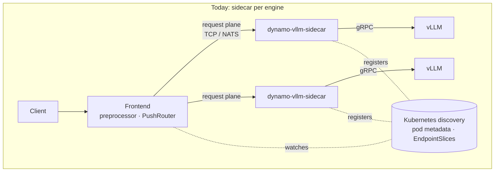
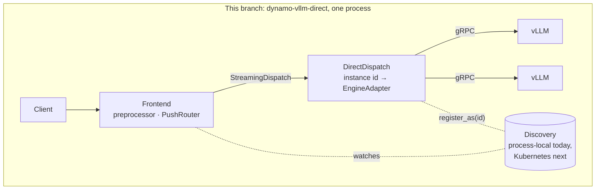
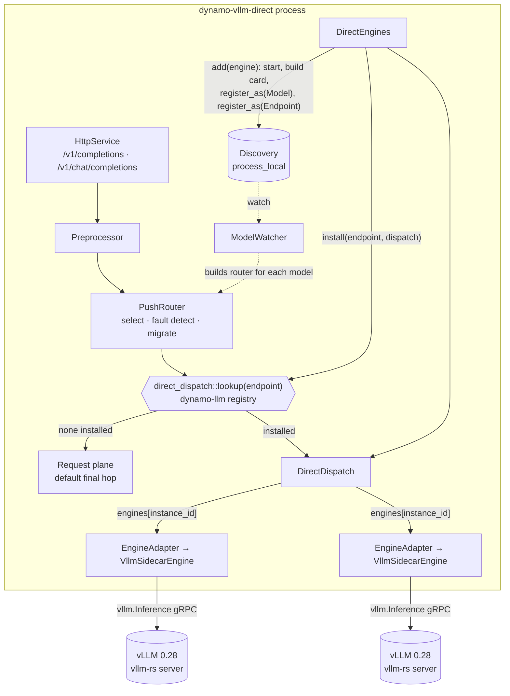
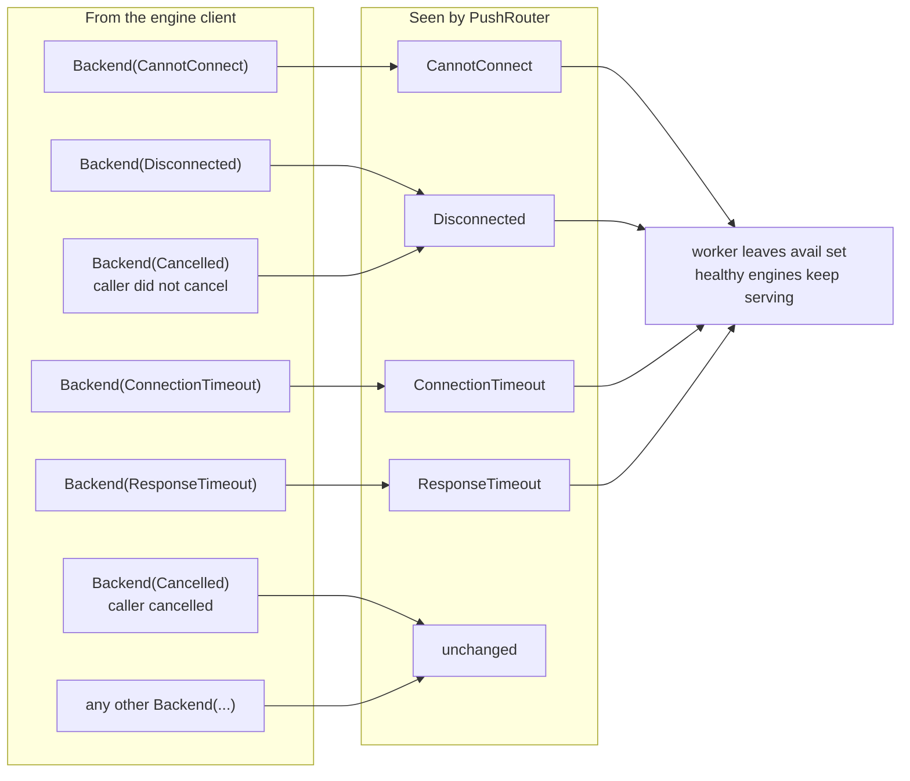

<!--
SPDX-FileCopyrightText: Copyright (c) 2026 NVIDIA CORPORATION & AFFILIATES. All rights reserved.
SPDX-License-Identifier: Apache-2.0
-->

# Frontend-direct serving (prototype)

`dynamo-vllm-direct` runs the stock Dynamo HTTP frontend with every vLLM
engine hosted **in the same process** as a worker. The router's final hop is
vLLM's own gRPC. There is no sidecar process, no etcd, no NATS and no request
plane in the path.

```bash
dynamo-vllm-direct --grpc-endpoint 127.0.0.1:50051 --grpc-endpoint 127.0.0.1:50052 --http-port 8000
```

## Before and after





Discovery is the one piece the direct process still owns. Today the runner uses
the process-local backend, since the frontend and its engines are the only
parties. In a cluster the same process should register its engines through the
Kubernetes discovery backend, so the operator and other frontends see them as
ordinary workers. `register_as` is implemented for the KV-store and mock
backends; the Kubernetes backend still refuses caller-chosen instance ids.

## The seam

`PushRouter` already ends in a `StreamingDispatch` trait object; the request
plane is just its default implementation. Everything above that seam is
untouched: the model watcher, the preprocessor, selection (`round_robin`,
`random`, `kv`, ...), occupancy, fault detection and migration.



## Error lifting

The engine client reports transport loss as `Backend(...)` errors, like every
engine. `PushRouter` quarantines a worker only on top-level transport types, so
`DirectDispatch` lifts them at the seam. A cancellation the caller never asked
for is the gRPC stream dying under the request, so it is lifted too.



## What changed, by crate

| Crate | Change |
|---|---|
| `dynamo-runtime` | `Discovery::register_as(spec, instance_id)` so N engines in one process register as distinct workers. KV-store and mock backends implement it. |
| `dynamo-backend-common` | `direct::DirectEngines` hosts `LLMEngine`s, registers each as a worker with the Worker's own model card, serves them through `DirectDispatch` (a `StreamingDispatch`), lifts transport faults. |
| `dynamo-llm` | `direct_dispatch` registry keyed by endpoint id. The frontend router builder takes an installed dispatch as the final hop instead of the request plane. |
| `dynamo-vllm-sidecar` | `dynamo-vllm-direct` binary: frontend plus every `--grpc-endpoint` in-process. |
| `dynamo-sidecar-testkit` | `tests/direct_engine_integration.rs`: four CPU-only scenarios over mock vLLM gRPC servers. |

## Verified

| Scenario | Result |
|---|---|
| Two engines register as distinct workers with model cards | pass |
| Request reaches the selected engine over gRPC, wire fields intact | pass |
| Lost engine surfaces as a transport fault and leaves the avail set | pass |
| Completion through the real HTTP frontend | pass |
| Real vLLM 0.28 (`vllm-rs` gRPC), Qwen3-0.6B: completions, chat, streaming, 16 concurrent | pass |

The dev image's vLLM 0.18 `[grpc]` extra speaks a different protocol (SMG
servicer) and cannot serve this path; vLLM ≥ 0.28 with its bundled `vllm-rs`
server is required, matching `deploy/`.

## Not yet

- `register_as` on the Kubernetes discovery backend, so a direct process
  publishes its engines through k8s and needs no in-process store.
- KV events into the indexer, so `--router-mode kv` is prefix-aware.
- `remove()` and health-driven unregister.
- `--direct-engine` flag in the Python frontend behind a cargo feature.
- SGLang and TRT-LLM engines on the same seam.
- AIPerf comparison against the sidecar path.
