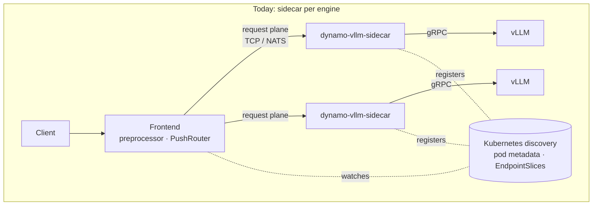
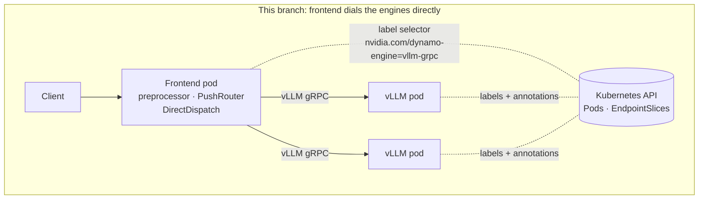
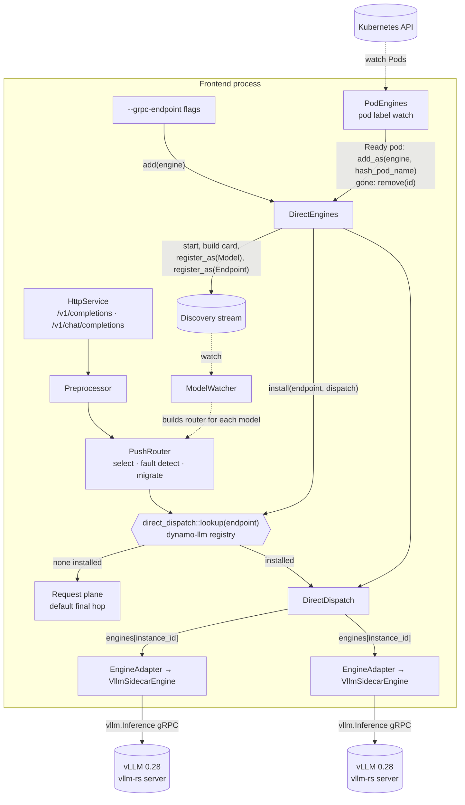
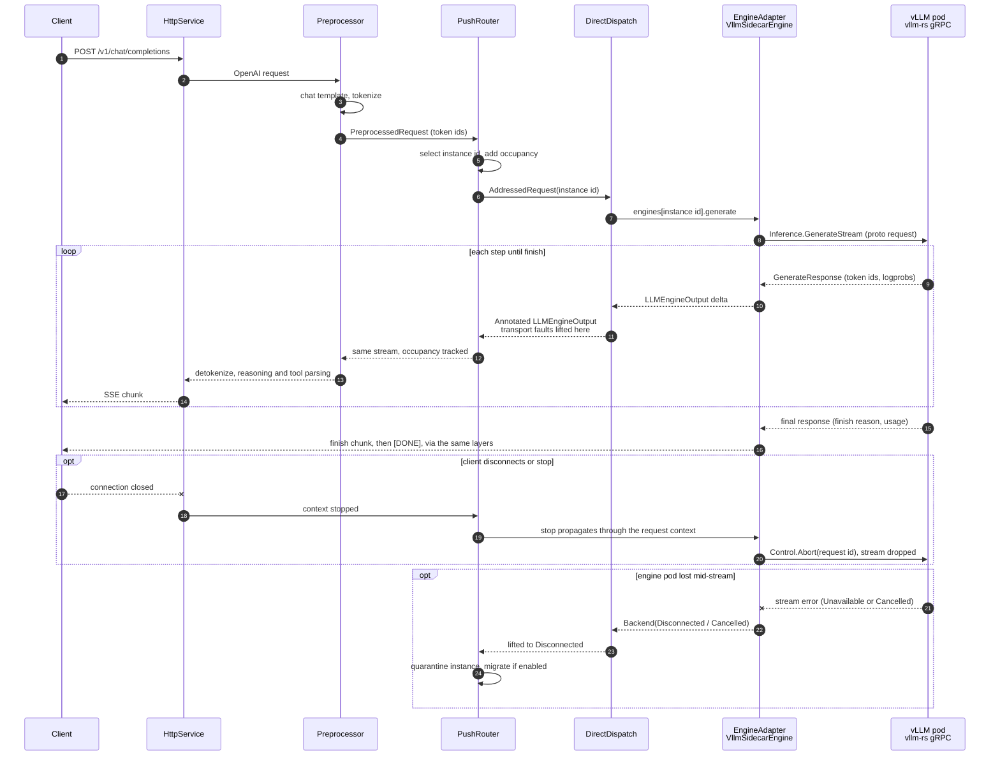
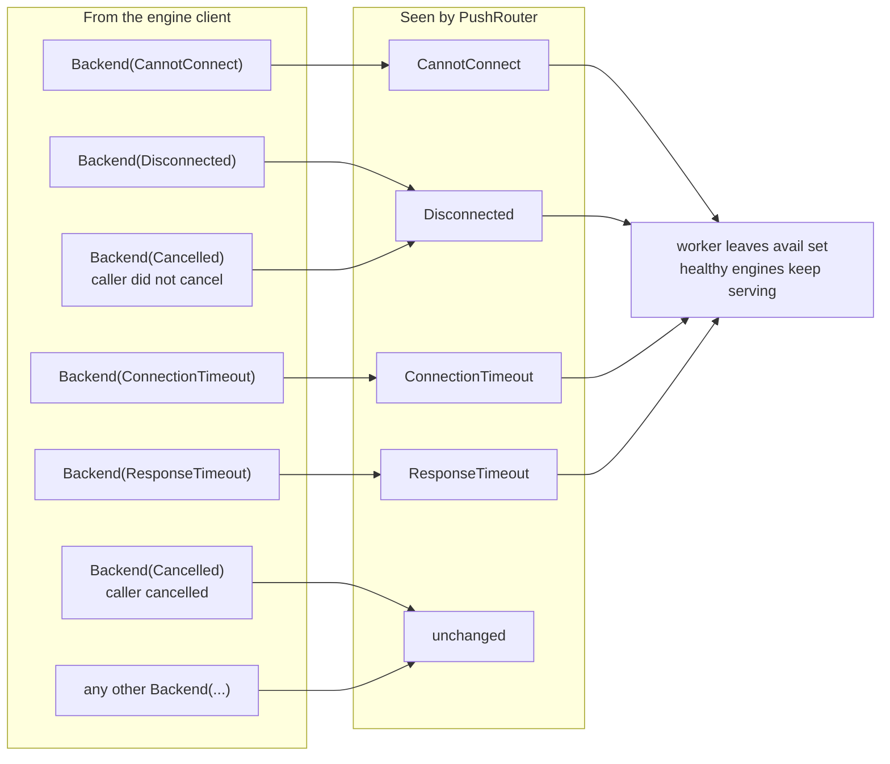

<!--
SPDX-FileCopyrightText: Copyright (c) 2026 NVIDIA CORPORATION & AFFILIATES. All rights reserved.
SPDX-License-Identifier: Apache-2.0
-->

# Frontend-direct serving (prototype)

`dynamo-vllm-direct` is the stock Dynamo HTTP frontend whose router dials
each vLLM engine's own gRPC server. The frontend and every vLLM server are
still separate processes (separate pods in a cluster). What is removed is the
hop between them: no sidecar process per engine, no request plane, no NATS.
Each engine is still an ordinary worker to the router, so selection, fault
detection and migration are unchanged.

```bash
# Engines from Kubernetes: every Ready pod labelled app=vllm, at <pod IP>:50051.
dynamo-vllm-direct --pod-selector app=vllm --pod-namespace inference --pod-grpc-port 50051

# Fixed engines, for local runs.
dynamo-vllm-direct --grpc-endpoint 127.0.0.1:50051 --grpc-endpoint 127.0.0.1:50052
```

## Before and after





Same processes as today minus the sidecars: one per frontend, one per vLLM
server. The frontend holds a gRPC client per engine.

### Discovery by label selector

Today's Kubernetes backend expects each worker pod to publish its own
`DynamoWorkerMetadata` CR; the daemon joins those CRs with pod or
EndpointSlice readiness under the labels
`nvidia.com/dynamo-discovery-backend=kubernetes` and
`nvidia.com/dynamo-discovery-enabled=true`. A stock vLLM pod runs no Dynamo
code and writes no CR, so for direct engines the frontend does the publishing
side itself:

| Step | Who | What |
|---|---|---|
| select | frontend | watch Pods matching `--pod-selector` in `--pod-namespace`; a pod serves once `Ready` and not terminating |
| address | pod | `<pod IP>:<--pod-grpc-port>`, or the pod's `nvidia.com/dynamo-engine-grpc-port` annotation; the model name and tokenizer come from the engine's own model and server info calls when the frontend connects |
| identify | frontend | instance id = `hash_pod_name(pod)`, the function the EPP already uses, so every frontend and the gateway derive the same id without coordination |
| publish | frontend | `DirectEngines::add_as(engine, id)` registers the `Model` and `Endpoint` instances in the frontend's own discovery, so `ModelWatcher`, `ModelManager` and the router see an ordinary worker |
| retire | frontend | pod NotReady, deleted, or missing from a relist: `DirectEngines::remove(id)` withdraws both records and cleans the engine up; the last worker leaving removes the model |

Each serving pod gets its own start task that retries with backoff (1 s,
doubling to 30 s), so an unreachable engine never holds back the others, and
retiring the pod cancels it. Nothing is registered by the engines and no
`DynamoWorkerMetadata` CR is needed, so `register_as` is not needed on the
Kubernetes backend either. In a cluster the frontend needs only this RBAC:

```yaml
apiVersion: rbac.authorization.k8s.io/v1
kind: Role
metadata: { name: direct-engine-watch }
rules:
  - apiGroups: [""]
    resources: [pods]
    verbs: [get, list, watch]
```

## The seam

`PushRouter` already ends in a `StreamingDispatch` trait object; the request
plane is just its default implementation. Everything above that seam is
untouched: the model watcher, the preprocessor, selection (`round_robin`,
`random`, `kv`, ...), occupancy, fault detection and migration.



## Request and response path

Both directions cross the same seam. The request goes down as a
`PreprocessedRequest`; the response comes back as a stream of
`LLMEngineOutput` deltas that each layer maps on its way up. There is no
response plane: the gRPC server stream *is* the response stream.



## Error lifting

The engine client reports transport loss as `Backend(...)` errors, like every
engine. `PushRouter` quarantines a worker only on top-level transport types, so
`DirectDispatch` lifts them at the seam. A cancellation the caller never asked
for is the gRPC stream dying under the request, so it is lifted too.



## What changed, by crate

| Crate | Change |
|---|---|
| `dynamo-runtime` | `Discovery::register_as(spec, instance_id)` so N engines in one process register as distinct workers. KV-store and mock backends implement it. |
| `dynamo-backend-common` | `direct::DirectEngines` hosts `LLMEngine`s (`add`, `add_as`, `remove`), registers each as a worker with the Worker's own model card, serves them through `DirectDispatch` (a `StreamingDispatch`), lifts transport faults. `direct::pods::PodEngines` keeps them in step with a pod label watch. |
| `dynamo-llm` | `direct_dispatch` registry keyed by endpoint id. The frontend router builder takes an installed dispatch as the final hop instead of the request plane. |
| `dynamo-vllm-sidecar` | `dynamo-vllm-direct` binary: frontend plus engines from `--grpc-endpoint` flags and/or `--pod-selector`. |
| `dynamo-sidecar-testkit` | `tests/direct_engine_integration.rs`: eight CPU-only scenarios over mock vLLM gRPC servers. |

## Verified

| Scenario | Result |
|---|---|
| Two engines register as distinct workers with model cards | pass |
| Request reaches the selected engine over gRPC, wire fields intact | pass |
| Lost engine surfaces as a transport fault and leaves the avail set | pass |
| Completion through the real HTTP frontend | pass |
| Ready pod becomes a worker keyed by `hash_pod_name` and serves | pass |
| NotReady or deleted pod is withdrawn, model card included; Ready again re-registers | pass |
| Relist withdraws pods it no longer contains | pass |
| Unreachable pod does not hold back a reachable one | pass |
| Pod mapping: Ready, terminating, IP, IPv6, pool port, annotation override (unit) | pass |
| Real vLLM 0.28 (`vllm-rs` gRPC), Qwen3-0.6B: completions, chat, streaming, 16 concurrent | pass |
| Pod label watch against a real API server (k3s) with real vLLM, below | pass |

### Pod watch against a real cluster

Run on a single-node k3s with vLLM's gRPC server on host loopback. The test
pods never run: a node selector keeps them Pending, and their status is
patched the way a kubelet would report it (pod IP `127.0.0.1`, `Ready`), so
the frontend dials the real engine without exposing it. Everything else is
real: the API server, the label-selector watch, its relists, status and
delete events.

| Step | Observed |
|---|---|
| frontend starts, pods Pending | relist of 3 selected pods; the unlabelled pod is not selected |
| 4 pods patched Ready | `vllm-a`, `vllm-b` serve as workers `de4b26baecf38`, `52b4eab3a06c1`; `vllm-dead` (annotation port 50059) retries; unlabelled pod ignored |
| completion, chat, streaming, 8 concurrent | all 200; both workers report TTFT, so round robin used both |
| `vllm-b` NotReady | withdrawn; requests keep returning 200 from `vllm-a` |
| `vllm-a` deleted | withdrawn; no workers left, `/v1/models` empty, requests 404 |
| `vllm-b` Ready again | re-registered under the same id; requests 200 |
| frontend restarted | initial relist hosts `vllm-b` before serving; requests 200 |

```bash
kubectl patch pod -n direct-engine-e2e vllm-a --subresource=status --type=merge -p \
  '{"status":{"phase":"Running","podIP":"127.0.0.1","podIPs":[{"ip":"127.0.0.1"}],
    "conditions":[{"type":"Ready","status":"True","lastTransitionTime":"2026-10-30T18:00:00Z"}]}}'
```

The dev image's vLLM 0.18 `[grpc]` extra speaks a different protocol (SMG
servicer) and cannot serve this path; vLLM ≥ 0.28 with its bundled `vllm-rs`
server is required, matching `deploy/`.

## Not yet

- Pod watch on a node that runs the engines for real (kubelet readiness,
  pod network), and per-pod disaggregation role and endpoint annotations.
- KV events into the indexer, so `--router-mode kv` is prefix-aware.
- `remove()` and health-driven unregister.
- `--direct-engine` flag in the Python frontend behind a cargo feature.
- SGLang and TRT-LLM engines on the same seam.
- AIPerf comparison against the sidecar path.
